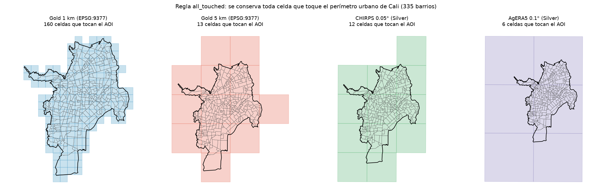
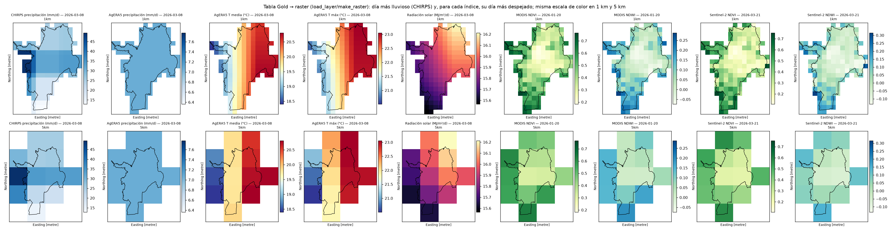
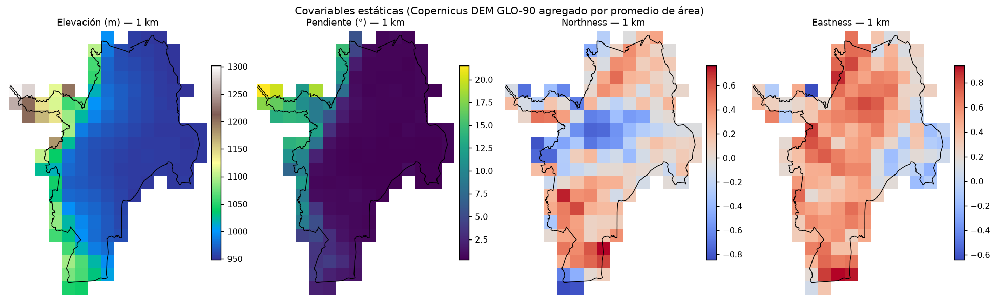
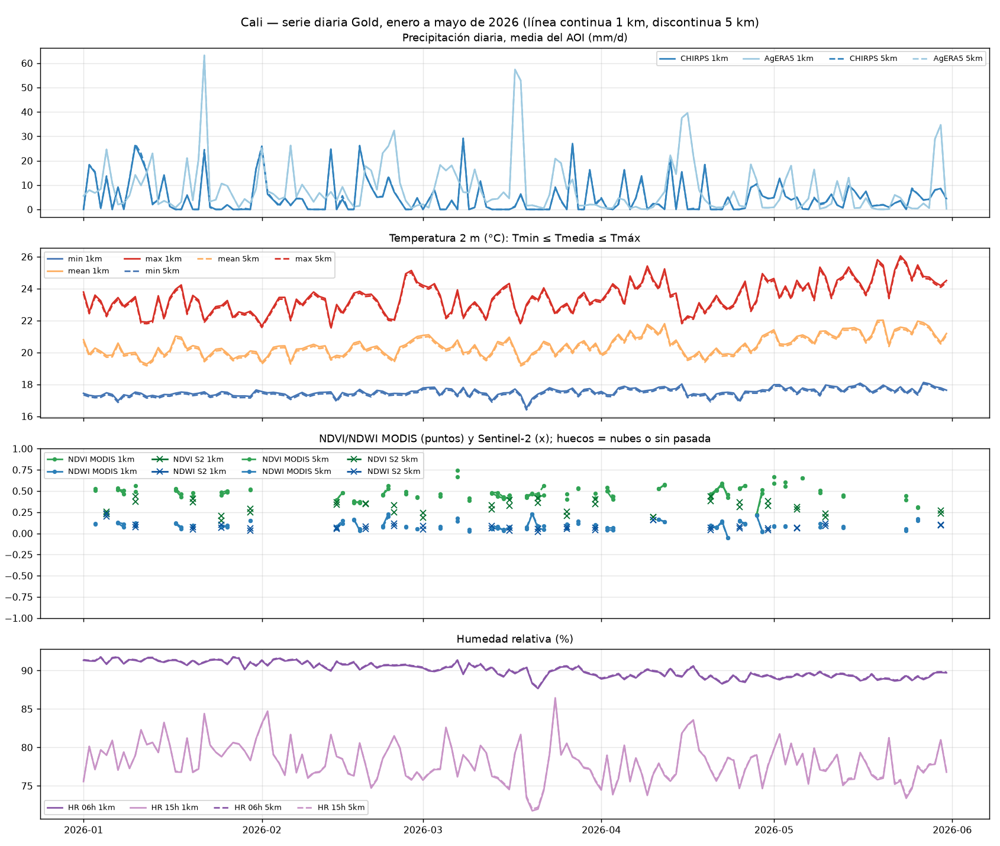
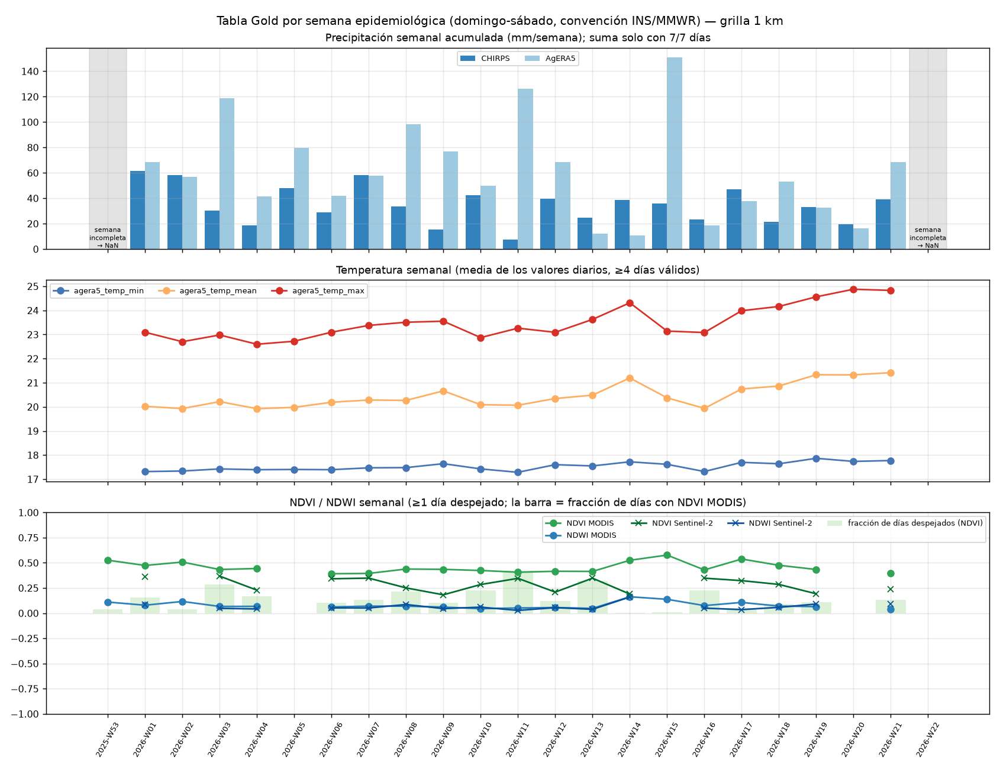
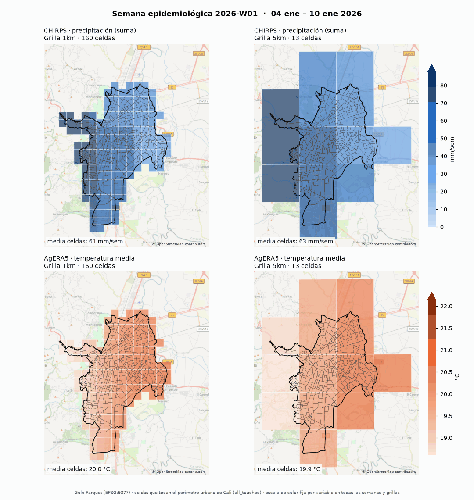
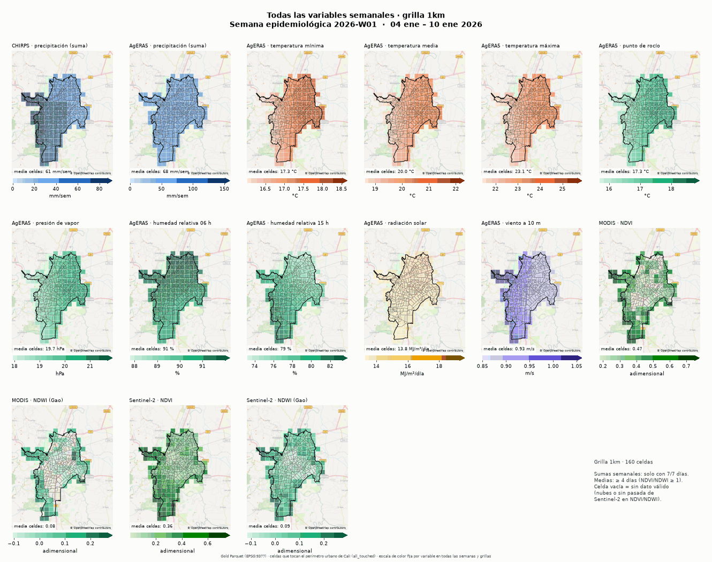
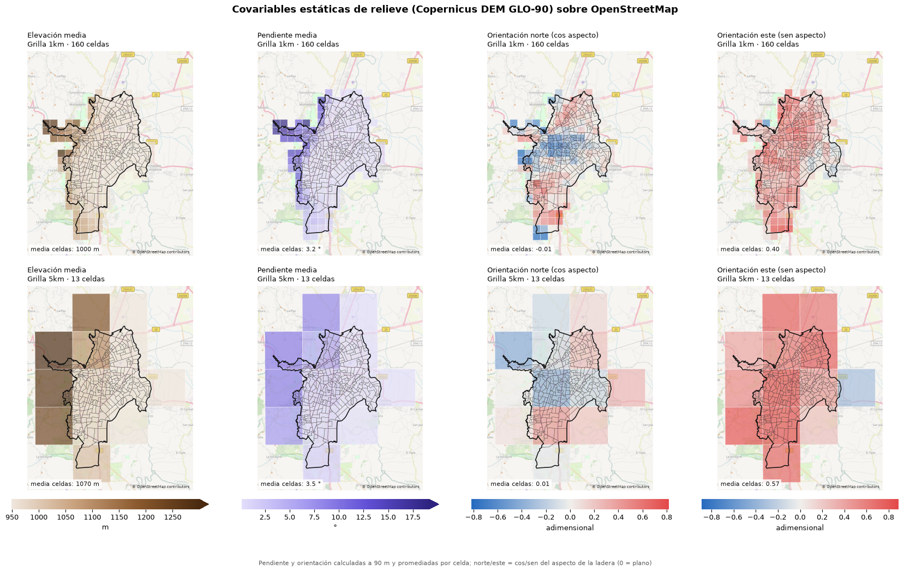

# Evidencias — corrida de ejemplo Cali (enero a mayo de 2026)

Estado global de QC: **TODOS LOS CHEQUEOS PASAN ✅** — ver [`qc/qc_summary.md`](qc/qc_summary.md). Decisión sobre la máscara de nubes de NDVI/NDWI: [`qc/gee_cloud_mask_diagnostic.md`](qc/gee_cloud_mask_diagnostic.md).

## Tablas Gold (una por grilla objetivo)

| Grilla | CRS | Celdas (ancho×alto) | Celdas en el AOI | Filas diarias | Filas semana epi. | Columnas diarias |
|---|---|---|---|---|---|---|
| 1km | EPSG:9377 | 15×20 | 160 | 24,160 | 3,680 | 19 |
| 5km | EPSG:9377 | 4×5 | 13 | 1,963 | 299 | 19 |

Rutas: `data/gold/<grilla>/parquet/{daily,epiweekly,static}/…` y `data/gold/<grilla>/climate.duckdb`.

## Estado del lago por fuente (catálogo `data/state/manifest/`)

| Fuente | Variables | Bronze final | Bronze prelim | Bronze missing | Días Silver | Productos de origen |
|---|---|---|---|---|---|---|
| agera5 | 10 | 1510 | 0 | 0 | 151 | `cds:sis-agrometeorological-indicators` |
| chirps | 1 | 151 | 0 | 0 | 151 | `gee:UCSB-CHG/CHIRPS/DAILY` |
| gee | 4 | 364 | 0 | 240 | 151 | `gee:COPERNICUS/S2_SR_HARMONIZED` `gee:MODIS/061/MOD09GA+MODIS/061/MYD09GA` |

Bronze cuenta pares (variable, día); `missing` son días que el proveedor no publica (p. ej. sin pasada de Sentinel-2); el planificador los vuelve a pedir (`retry_missing`) en las corridas que cubran esas fechas. Historial de corridas (`reports/`):

| Reporte | Inicio (UTC) | Fuentes | --force | OK | Fallos | Qué hizo |
|---|---|---|---|---|---|---|
| `run_chirps_gee_mirror.json` | 2026-10-28T04:46:50+00:00 | chirps | sí | ✅ |  | CHIRPS v2 re-descargado desde el espejo de GEE (CHC bloqueó la IP con 403) |
| `run_gee_terra_aqua.json` | 2026-10-28T04:54:04+00:00 | gee | sí | ✅ |  | MODIS Terra+Aqua con la máscara estricta (incluía adyacencia); reemplazada |
| `run_gee_s2_standard_mask.json` | 2026-10-28T15:08:30+00:00 | gee | sí | ✅ |  | MODIS con máscara `standard` + Sentinel-2 (Cloud Score+); vigente |
| `run_parquet.json` | 2026-10-28T15:17:47+00:00 | chirps, agera5, gee | no | ✅ |  | corrida del script de ejemplo: todo al día, sin descargas pendientes |

## Hallazgos (calculados sobre los datos)

- **Precipitación AgERA5 en bloques:** en 100% de los días todas las celdas de 1 km del AOI tienen el mismo valor. El dato crudo de AgERA5 ya viene así: la precipitación es la de ERA5 (~0.25°) replicada en la grilla de 0.1°, sin reducción de escala, a diferencia de la temperatura. Para la estructura espacial de la lluvia, usar CHIRPS.
- **CHIRPS vs AgERA5:** acumulado ene-may de 764 mm (CHIRPS) vs 1306 mm (AgERA5) como media del AOI; correlación semanal r = -0.03 en 21 semanas completas. La correlación diaria es máxima con desfase 0, así que las fechas están alineadas: la baja concordancia es propia de los productos (ERA5 sobreestima la lluvia convectiva andina), no un error.
- **Temperatura media AgERA5:** 19.3-22.0 °C (media 20.5 °C), por debajo de la climatología habitual de Cali (~24 °C): sesgo frío conocido del reanálisis en valles andinos (orografía suavizada). La conversión K → °C se verificó contra Bronze (ver QC); las covariables de elevación existen para corregir este sesgo en el downscaling.
- **Nubosidad y NDVI/NDWI:** el 34% de los días tiene al menos una celda de 1 km con NDVI MODIS válido (Terra+Aqua, máscara `standard`: nube, sombra y nube interna). Por semana epidemiológica hay NDVI en el 62% de las celdas-semana con MODIS, 67% con Sentinel-2 y 78% con al menos uno de los dos (antes, con la máscara estricta y ≥2 días, la tabla tenía 7 %). El código original no enmascaraba nubes: tenía pocos NA, pero el NDVI de los píxeles nublados es ~0.12 (mediana) frente a ~0.67 despejado, así que esos valores eran nubes, no vegetación.
- **QC en acción:** el control de rangos descartó 0 valor(es) de NDVI > 1 y 0 < -1; 0 violaciones de Tmin ≤ Tmedia ≤ Tmáx en ambas grillas.
- **Semanas incompletas:** 2025-W53 (1-3 ene) y 2026-W22 (31 may) tienen menos de 7 días en el rango, así que la precipitación semanal queda en NaN y la columna `*_ndays` lo documenta.

## Figuras

### Mapas por semana epidemiológica sobre OpenStreetMap ([`animations/`](animations/))

Generados con `examples/cali_2026/make_weekly_gif.py` desde los Parquet gold. Cada mapa dibuja el shapefile de Cali, y la escala de color de cada variable es la misma en todas las semanas y en ambas grillas.

- `weekly_1km_vs_5km.gif`: precipitación CHIRPS y temperatura media AgERA5, grillas 1 km y 5 km.
- `all_variables_1km.gif` / `all_variables_5km.gif`: todos los campos semanales a la vez.
- Un GIF por campo, 1 km al lado de 5 km: `make_weekly_gif.py --per-field` (no se versiona).
- `maps/04_static_covariates_osm.png`: elevación, pendiente y orientación en ambas grillas.

