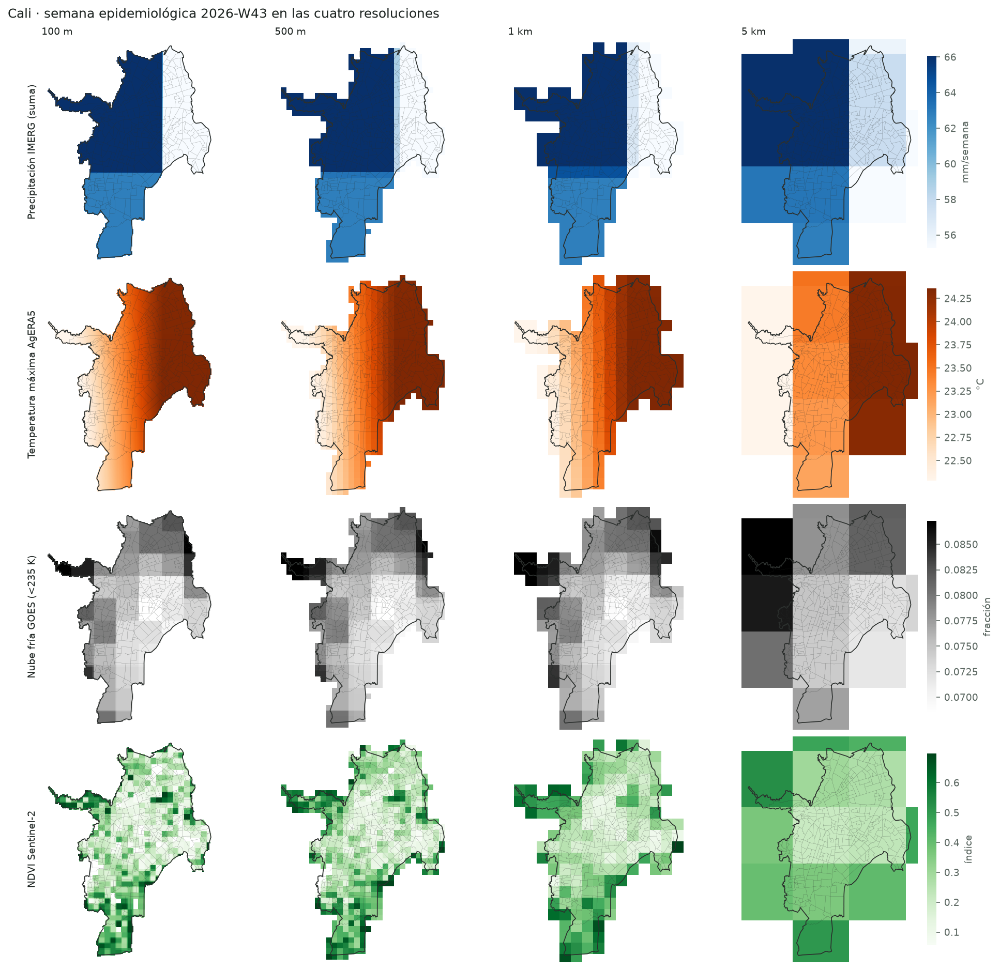
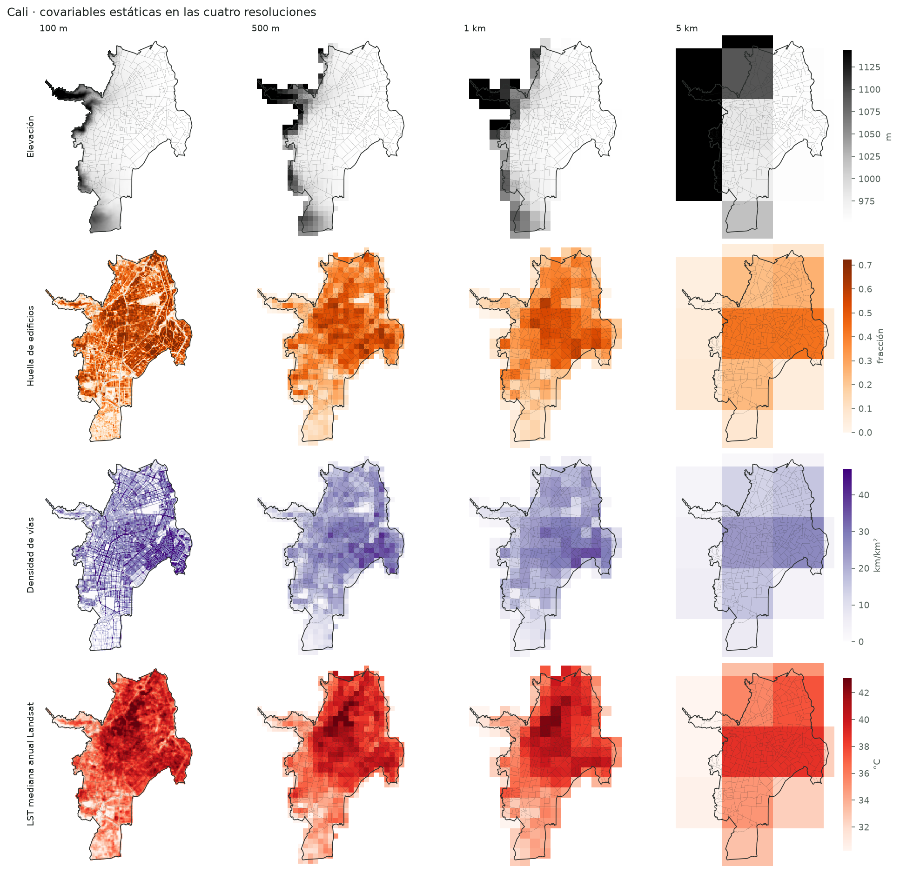
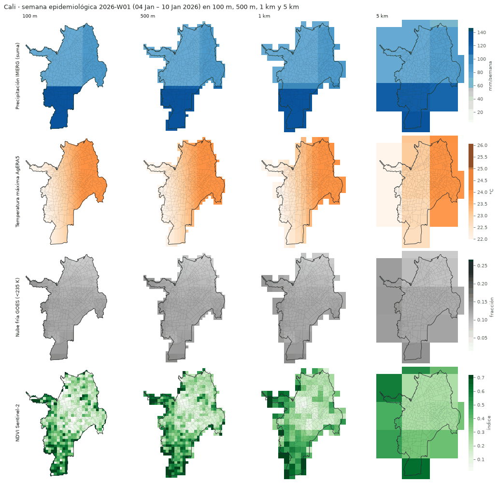
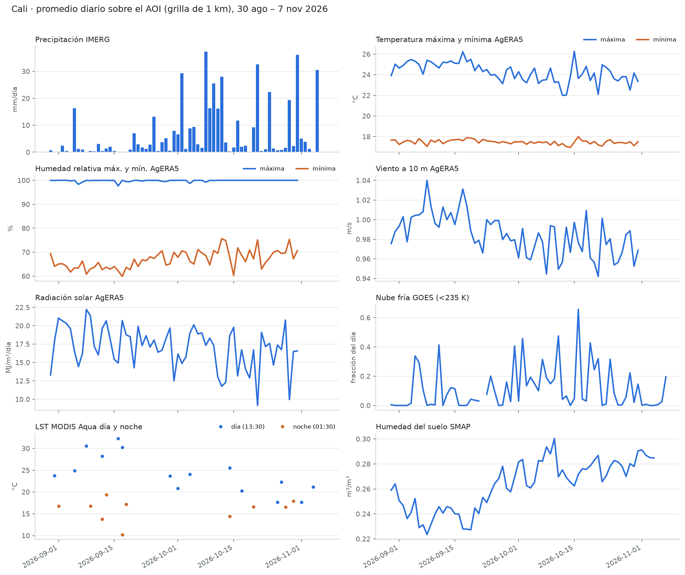
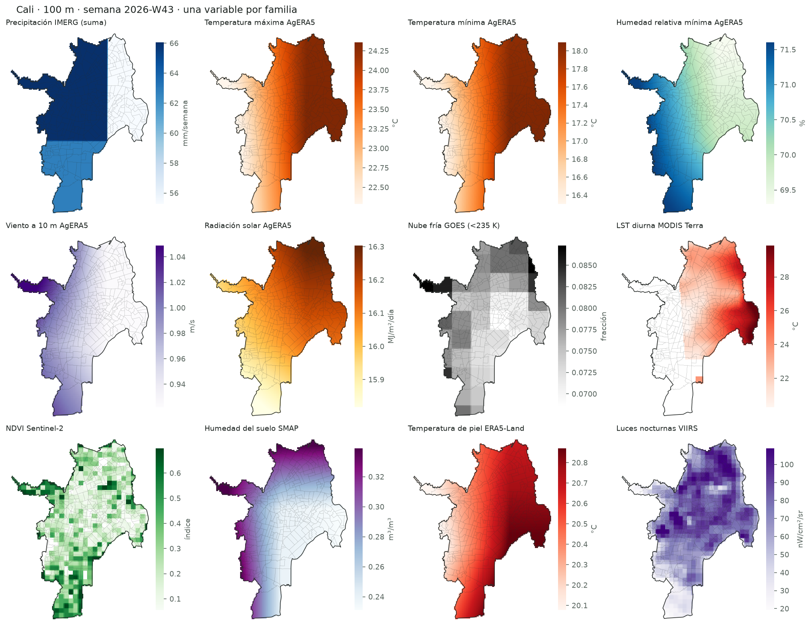
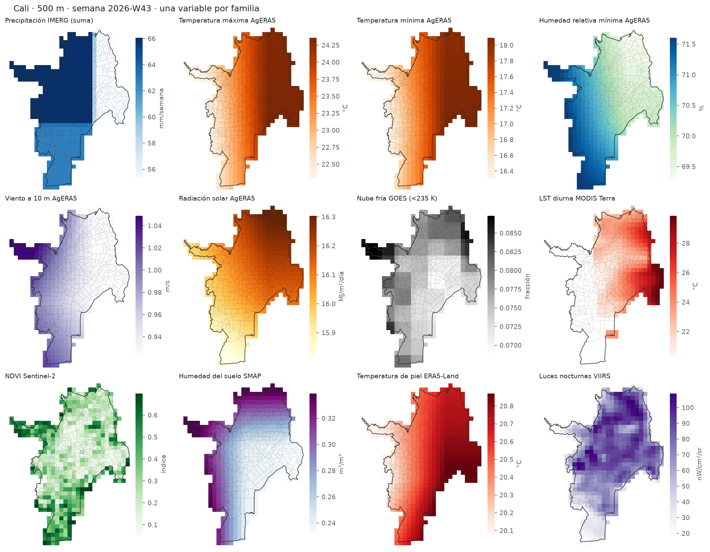
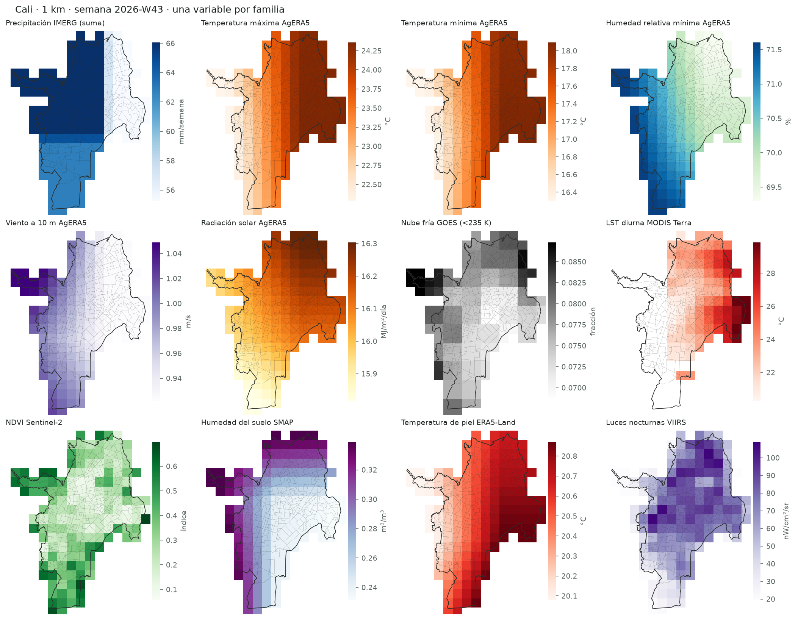
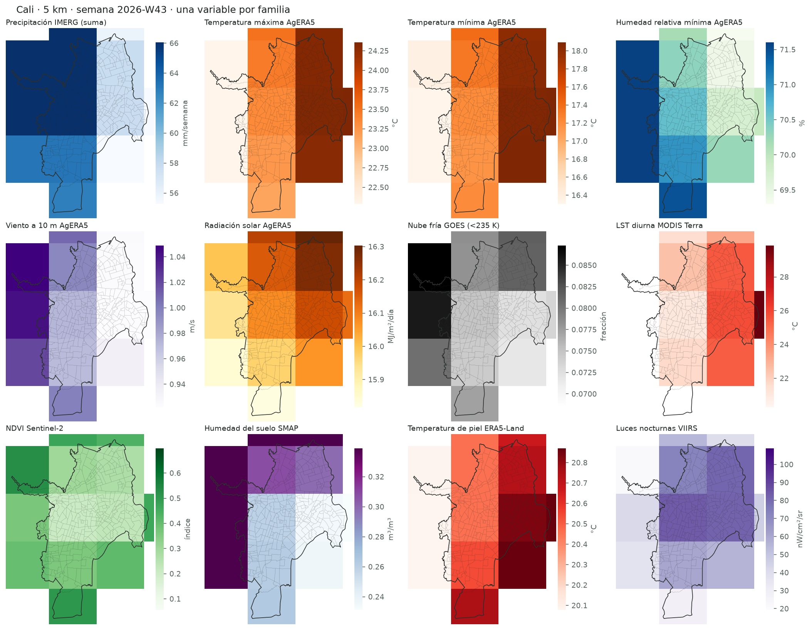

# Evidencias — corrida operativa de Cali (fuentes diarias seleccionadas, cuatro resoluciones)

Generado por `examples/cali_operational/run_pipeline.sh`. Las fuentes se descargan en su grilla nativa y Gold se genera en cada resolución pedida (**100 m, 500 m, 1 km y 5 km**) directamente desde esos datos.

## Tablas Gold por grilla

| grid | resolution_m | shape (h×w) | cells_in_aoi | daily_rows | epiweekly_rows | first_day | last_day | daily_columns | static_columns |
|---|---|---|---|---|---|---|---|---|---|
| 100m | 100.0 | 189×145 | 12535 | 877450 | 125350 | 2026-08-30 | 2026-11-07 | 73 | 24 |
| 500m | 500.0 | 39×29 | 570 | 39900 | 5700 | 2026-08-30 | 2026-11-07 | 73 | 24 |
| 1km | 1000.0 | 20×15 | 160 | 11200 | 1600 | 2026-08-30 | 2026-11-07 | 73 | 24 |
| 5km | 5000.0 | 5×4 | 13 | 910 | 130 | 2026-08-30 | 2026-11-07 | 73 | 24 |

Rutas: `data/operational/gold/<grilla>/parquet/{daily,epiweekly,static}/`.

## Consistencia entre escalas

Cada grilla se calcula directamente desde los datos nativos a su resolución. Para comprobar que las escalas coinciden se compara cada celda gruesa con el promedio de sus celdas de la grilla más fina (`parent_cell_ids`):

| fine | grid | date | column | cells | mean_abs_diff | correlation |
|---|---|---|---|---|---|---|
| 100m | 500m | 2026-08-30 | imerg_precip | 570 | 0.001 | 0.9987 |
| 100m | 500m | 2026-08-30 | agera5_temp_max | 570 | 0.004 | 0.9999 |
| 100m | 500m | 2026-08-30 | goes_cold_cloud_frac_235 | 570 | 0.0 | 0.9982 |
| 100m | 500m | 2026-08-30 | modis_cloud_frac | 375 | 0.0 |  |
| 100m | 1km | 2026-08-30 | imerg_precip | 160 | 0.0082 | 0.956 |
| 100m | 1km | 2026-08-30 | agera5_temp_max | 160 | 0.0129 | 0.9993 |
| 100m | 1km | 2026-08-30 | goes_cold_cloud_frac_235 | 160 | 0.0001 | 0.9964 |
| 100m | 1km | 2026-08-30 | modis_cloud_frac | 105 | 0.0 |  |
| 100m | 5km | 2026-08-30 | imerg_precip | 13 | 0.0868 | 0.6278 |
| 100m | 5km | 2026-08-30 | agera5_temp_max | 13 | 0.1427 | 0.9838 |
| 100m | 5km | 2026-08-30 | goes_cold_cloud_frac_235 | 13 | 0.0005 | 0.9851 |
| 100m | 5km | 2026-08-30 | modis_cloud_frac | 10 | 0.0 |  |

## Cobertura por fuente (grilla 100m)

`mean_coverage_pct` = porcentaje de valores diarios no nulos (las fuentes ópticas bajan por nubes; los días aún no publicados quedan como NA).

| source | columns | mean_coverage_pct | last_date |
|---|---|---|---|
| agera5 | 21 | 90.0 | 2026-10-31 |
| era5land | 13 | 91.4 | 2026-11-01 |
| gee | 10 | 13.3 | 2026-11-04 |
| goes | 14 | 98.6 | 2026-11-07 |
| imerg | 1 | 95.7 | 2026-11-05 |
| landsat | 1 | 3.1 | 2026-11-01 |
| modis | 7 | 13.7 | 2026-11-05 |
| sentinel1 | 3 | 24.3 | 2026-10-31 |
| smap | 2 | 95.7 | 2026-11-04 |
| viirs | 1 | 84.3 | 2026-10-30 |

Detalle por columna: [`tables/column_inventory.csv`](tables/column_inventory.csv).

## Figuras

Generadas con `examples/cali_operational/make_figures.py`.

**Variables clave de la última semana completa en 100 m, 500 m, 1 km y 5 km**

**Terreno y forma urbana en las cuatro resoluciones**

**Precipitación IMERG y Tmáx AgERA5 semana a semana, cuatro resoluciones**

**Promedio diario sobre Cali de una variable por familia**

**Una variable por familia, 100 m**

**Una variable por familia, 500 m**

**Una variable por familia, 1 km**

**Una variable por familia, 5 km**

## Disponibilidad operativa al 2026-11-08

| source | latest_day | lag_days | last_complete_epiweek | status | method |
|---|---|---|---|---|---|
| imerg | 2026-11-06 | 2 | 2026-W43 | prelim | probe |
| agera5 | 2026-10-31 | 8 | 2026-W43 | final | config |
| gee | 2026-11-06 | 2 | 2026-W43 | final | probe |
| era5land | 2026-11-01 | 7 | 2026-W43 | final | probe |
| modis | 2026-11-05 | 3 | 2026-W43 | final | probe |
| viirs | 2026-10-30 | 9 | 2026-W42 | final | probe |
| smap | 2026-11-05 | 3 | 2026-W43 | final | probe |
| landsat | 2026-11-01 | 7 | 2026-W43 | final | probe |
| goes | 2026-11-07 | 1 | 2026-W44 | final | probe |
| sentinel1 | 2026-11-06 | 2 | 2026-W43 | final | probe |

Todas las fuentes completas hasta **2026-10-30** (semana epidemiológica **2026-W42**).
